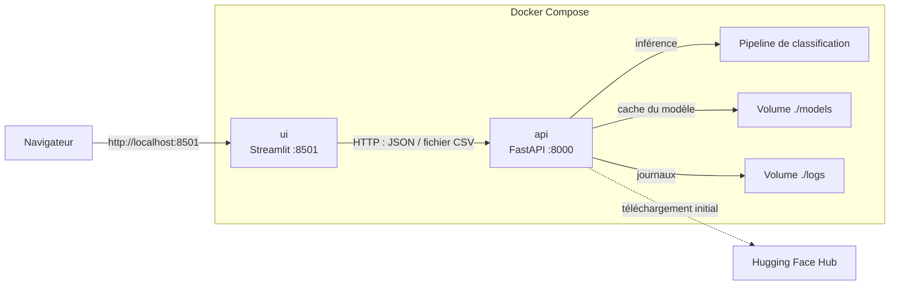

# Escale Atlantique — Sentiment des avis clients

Application de classification des avis clients en **négatif**, **neutre** ou
**positif**. Le modèle Hugging Face
[`cmarkea/distilcamembert-base-sentiment`](https://huggingface.co/cmarkea/distilcamembert-base-sentiment)
produit des scores de 1 à 5 étoiles, ensuite convertis en ces trois classes.

## Architecture



Le navigateur ouvre l'interface Streamlit sur le port `8501`. Dans Docker,
l'interface appelle FastAPI à l'adresse `http://api:8000`. Au premier démarrage,
l'API télécharge le modèle depuis Hugging Face puis conserve ses fichiers dans
`models/`; ses journaux sont écrits dans `logs/`. Docker Compose attend que le
contrôle de santé de l'API réussisse avant de démarrer l'interface.

## Prérequis

- Docker Desktop (ou Docker Engine) avec Docker Compose v2.
- Un accès Internet au premier lancement pour télécharger les fichiers du modèle.
  Les lancements suivants réutilisent le cache de `models/`.

Python n'a pas besoin d'être installé sur l'hôte : les dépendances de l'API et
de l'interface sont installées dans leurs conteneurs respectifs.

## Installation et lancement

Depuis la racine du dépôt, créez avec un éditeur de texte un fichier nommé
exactement `.env` (sans extension supplémentaire). Compose en a besoin pour
démarrer les conteneurs. Collez-y ces deux lignes :

```dotenv
API_URL=http://api:8000
MODEL_NAME=cmarkea/distilcamembert-base-sentiment
```

Construisez les images et démarrez les deux services en arrière-plan :

```bash
docker compose up --build -d
```

Le premier démarrage peut prendre quelques minutes : l'API télécharge le modèle
(environ 270 Mo) avant de devenir disponible. Vérifiez que les conteneurs sont
prêts :

```bash
docker compose ps
```

L'API doit être indiquée comme `healthy` et l'interface comme `running`. Ouvrez
ensuite :

- Interface : <http://localhost:8501>
- Vérification de santé de l'API : <http://localhost:8000/health>
- Documentation interactive de l'API : <http://localhost:8000/docs>
- Informations sur le modèle et les classes : <http://localhost:8000/info>

Pour suivre les journaux :

```bash
docker compose logs -f api ui
```

Cette commande affiche les journaux en continu ; `Ctrl+C` arrête leur affichage,
mais laisse les conteneurs démarrés.

Pour arrêter les services :

```bash
docker compose down
```

Les dossiers `models/` et `logs/` sont montés depuis l'hôte et persistent après
l'arrêt des conteneurs.

## API

| Route | Description |
|---|---|
| `GET /health` | État du service et indication de chargement du modèle |
| `GET /info` | Nom du modèle et classes de sortie |
| `POST /predict` | Classe un avis envoyé en JSON |
| `POST /predict/batch` | Analyse un fichier CSV ou Excel annoté |

Une requête `POST /predict` contient le texte et la conversion choisie :

```json
{
  "text": "Chambre propre, personnel adorable.",
  "conversion": "Conversion 1"
}
```

Pour l'analyse par lot, le fichier doit comporter les colonnes `id`, `texte` et
`sentiment_attendu`. L'API renvoie notamment les prédictions, la matrice de
confusion, le rapport de classification et l'accuracy. L'interface Streamlit
permet de téléverser un fichier CSV.

## Conversion

**Règles de conversion des étoiles en sentiments :**

| Note du modèle | Sentiment |
|---|---|
| 1 star | **négatif** |
| 2 stars | **négatif** |
| 3 stars | **neutre** |
| 4 stars | **positif** |
| 5 stars | **positif** |

Les notes 1 et 2 sont regroupées en **négatif**, car elles indiquent une
insatisfaction ; la note 3 devient **neutre**, tandis que les notes 4 et 5
deviennent **positif**. Le modèle attribue un score à chacune des cinq notes.
L'application additionne les scores des étoiles associées à chaque sentiment,
puis choisit le sentiment dont le total est le plus élevé : elle ne se base donc
pas uniquement sur l'étoile ayant le score individuel maximal.

Par exemple, si les scores sont `1 star = 0,30`, `2 stars = 0,25`,
`3 stars = 0,20`, `4 stars = 0,15` et `5 stars = 0,10`, les totaux sont
**négatif = 0,55**, **neutre = 0,20** et **positif = 0,25**. Le résultat est
donc **négatif**.

## Conversion 2

**Règles de conversion des étoiles en sentiments :**

| Note du modèle | Sentiment |
|---|---|
| 1 star | **négatif** |
| 2 stars | **neutre** |
| 3 stars | **neutre** |
| 4 stars | **positif** |
| 5 stars | **positif** |

Cette variante réserve la classe **négatif** aux avis d'une étoile. Les avis de
2 ou 3 étoiles sont considérés comme **neutres** : elle adopte donc une
interprétation moins sévère des avis mitigés que la Conversion 1. Comme pour
l'autre conversion, l'application additionne les scores des étoiles associées
à chaque sentiment et choisit le total le plus élevé.

## Comparaison des conversions

Les deux conversions ont été évaluées sur les **mêmes 30 avis annotés**. Dans
les matrices ci-dessous, les lignes indiquent le sentiment attendu et les
colonnes le sentiment prédit.

### Conversion 1

| Attendu \ Prédit | Négatif | Neutre | Positif |
|---|---:|---:|---:|
| Négatif | 10 | 0 | 2 |
| Neutre | 1 | 5 | 2 |
| Positif | 1 | 0 | 9 |

Résultat : **24/30 bonnes prédictions, soit 80 % d'accuracy**.

### Conversion 2

| Attendu \ Prédit | Négatif | Neutre | Positif |
|---|---:|---:|---:|
| Négatif | 5 | 5 | 2 |
| Neutre | 0 | 6 | 2 |
| Positif | 1 | 0 | 9 |

Résultat : **20/30 bonnes prédictions, soit 67 % d'accuracy** (20/30 arrondi).

### Interprétation et choix

La Conversion 1 obtient **4 bonnes prédictions de plus** et une accuracy
supérieure de **13,3 points** (80 % contre 66,7 % avant arrondi). Elle reconnaît
**10 avis négatifs sur 12**, contre **5 sur 12** avec la Conversion 2 : cette
dernière classe 5 avis négatifs comme neutres. Les deux conversions reconnaissent
également **9 avis positifs sur 10**.
En revanche, la Conversion 2 classe correctement **6 avis neutres sur 8**,
contre **5 sur 8** pour la Conversion 1.

Si l'on définit une erreur grave comme un avis réellement négatif prédit neutre
ou positif, la Conversion 1 en fait **2 sur 12 (16,7 %)**, tous prédits positifs.
La Conversion 2 en fait **7 sur 12 (58,3 %)** : 5 sont prédits neutres et 2
positifs. La Conversion 1 rate ainsi **5 avis négatifs de moins** ; c'est le
meilleur choix parmi ces deux résultats pour prioriser les clients mécontents.

Pour cet échantillon, la Conversion 1 est donc préférable si la priorité est de
repérer les clients mécontents : elle manque moins d'avis négatifs. La Conversion
2 identifie un avis neutre supplémentaire, mais au prix de plusieurs avis
négatifs classés neutres. Ce choix s'appuie sur ces 30 avis seulement ; il ne
garantit pas les mêmes performances sur de nouvelles données.

## Analyser les erreurs

Les exemples ci-dessous illustrent des erreurs observées et des hypothèses
possibles sur leur origine. Ils ne constituent pas une explication certaine du
raisonnement interne du modèle. Les règles appliquées sont :

| Note | Conversion 1 | Conversion 2 |
|---|---|---|
| 1 star | **négatif** | **négatif** |
| 2 stars | **négatif** | **neutre** |
| 3 stars | **neutre** | **neutre** |
| 4 stars | **positif** | **positif** |
| 5 stars | **positif** | **positif** |

### Exemples — Conversion 1

| Texte | Sentiment réel | Sentiment prédit | Hypothèse |
|---|---|---|---|
| *Bravo pour l'insonorisation : j'ai pu suivre en direct toute la soirée de mes voisins jusqu'à 3 h du matin. Merci pour l'expérience.* | négatif | positif | **Ironie** : « Bravo » et « Merci » semblent positifs, mais le texte décrit une nuisance. |
| *Super, la « vue mer » donnait sur le parking. Heureusement qu'il y avait la photo du site pour imaginer.* | négatif | positif | **Ironie** : le vocabulaire positif masque la déception sur la vue. |
| *Pas une seule fausse note, on ne pouvait pas rêver mieux.* | positif | négatif | **Négation et expression idiomatique** : malgré le mot « pas », l'expression signifie que tout était parfait. |

### Exemples — Conversion 2

Les six exemples suivants illustrent certains types d'erreurs ; la matrice de
confusion en compte davantage.

| Texte | Sentiment réel | Sentiment prédit | Hypothèse |
|---|---|---|---|
| *Bravo pour l'insonorisation : j'ai pu suivre en direct toute la soirée de mes voisins jusqu'à 3 h du matin. Merci pour l'expérience.* | négatif | positif | **Ironie** : « Bravo » et « Merci » semblent positifs, mais le texte décrit une nuisance. |
| *Super, la « vue mer » donnait sur le parking. Heureusement qu'il y avait la photo du site pour imaginer.* | négatif | positif | **Ironie** : le vocabulaire positif masque la déception sur la vue. |
| *Pas une seule fausse note, on ne pouvait pas rêver mieux.* | positif | négatif | **Négation et expression idiomatique** : le mot « pas » pourrait être mal interprété malgré le sens positif de l'expression. |
| *Ancien habitué, je suis déçu : depuis la rénovation l'hôtel a perdu son âme et les prix ont doublé.* | négatif | neutre | **Contexte implicite** : la déception repose sur une comparaison avec les séjours passés. |
| *Je ne dirais pas que c'était horrible, mais je ne reviendrai pas.* | négatif | neutre | **Litote** : la critique est atténuée, alors que la décision de ne pas revenir indique une forte insatisfaction. |
| *La climatisation fuyait sur le lit et personne n'est venu malgré trois appels. [Coordonnées personnelles masquées].* | négatif | neutre | **Informations accessoires** : des détails administratifs ou des coordonnées peuvent détourner l'attention du problème principal. |

## Tests

La suite de tests de l'API utilise `pytest` et `TestClient`. Le fixture de test
charge le modèle réel une seule fois pour la session ; le premier lancement des
tests peut donc lui aussi nécessiter un téléchargement.

Depuis la racine du dépôt, lancez tous les tests dans un conteneur temporaire :

```bash
docker compose run --build --rm api pytest -v
```

Pour cibler les tests de santé ou de prédiction :

```bash
docker compose run --build --rm api pytest -v tests/test_health.py tests/test_predict.py
```

Les tests couvrent les routes de santé et d'information, le contrat de
prédiction, la validation des entrées, la journalisation et l'analyse par lot.
Après une modification du code, reconstruisez et recréez les conteneurs avant
d'utiliser l'application :

```bash
docker compose up -d --build --force-recreate api ui
```

## Journalisation

Chaque requête `POST /predict` produit une entrée applicative Loguru, par
exemple :

```text
POST /predict | texte='Chambre propre, personnel adorable.' | sentiment=positif | statut=200 | duree_ms=162.06
```

- Seuls les 80 premiers caractères du texte sont enregistrés ; le modèle reçoit
  le texte validé complet. Les retours à la ligne sont échappés pour conserver
  une seule ligne physique.
- Un succès est journalisé au niveau `INFO`, une requête refusée (422) au niveau
  `WARNING`, et une erreur serveur au niveau `ERROR`.
- Les entrées sont écrites dans la console et dans `logs/api.log`. Le fichier
  tourne à 5 Mo ; les archives sont compressées et conservées 7 jours. Les
  journaux d'accès Uvicorn sont distincts des entrées applicatives.

**Tronquer n'anonymise pas** : un nom ou un courriel peut déjà apparaître dans
les 80 premiers caractères. Limitez l'accès aux journaux et ne les versionnez
pas. Pour des données réelles, envisagez de ne pas enregistrer le texte libre.

## Données annotées

`data/avis_annotes.csv` contient 30 avis clients annotés par l'équipe qualité.
Les données sont censées être anonymisées ; vérifiez-les avant toute diffusion.

| Colonne | Contenu |
|---|---|
| `id` | Identifiant de l'avis |
| `hotel` | `City Hotel` ou `Resort Hotel` |
| `source` | Booking, Google, TripAdvisor ou Questionnaire |
| `texte` | Avis rédigé par le client |
| `sentiment_attendu` | Annotation de l'équipe qualité |

Consigne d'annotation :

- **négatif** : l'insatisfaction domine, ou un incident appelle une réponse ;
- **neutre** : avis factuel ou mitigé sans tendance dominante ;
- **positif** : la satisfaction domine, même avec un petit bémol.
